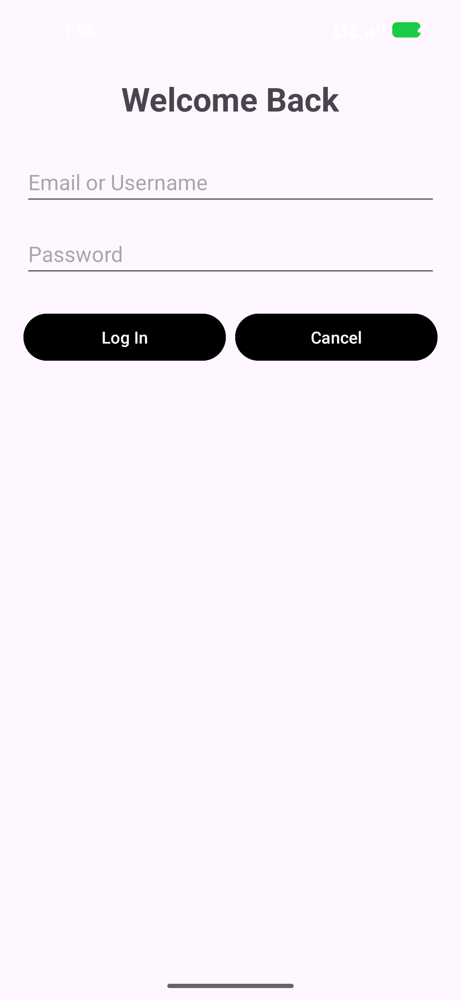

# Practical 3: Version Control

Student ID: 20243007046

This project uses the Android login application from [Practical3_GitHub](https://github.com/jibrilmuhammadadam/Practical3_GitHub). The original Commit 001 is preserved.

## Application changes

| Commit | Change | Screenshot |
| --- | --- | --- |
| 002 | Centered the Welcome Back heading | [View](screenshots/commit-002.png) |
| 003 | Added Cancel beside Log In, with equal button widths | [View](screenshots/commit-003.png) |
| 004 | Changed both buttons to black with white text | [View](screenshots/commit-004.png) |



## Branches

`main` contains the completed application. The button colour change was developed on `feature-button-background-color` and merged into `main` with a fast-forward merge. The feature branch is retained.

```text
Commit 001 -> Commit 002 -> Commit 003 -> Commit 004
                                         main
                                         feature-button-background-color
```

## Running the app

Open the project in Android Studio, complete Gradle sync, and run the `app` configuration on an emulator. The project uses JDK 25, Gradle 9.6.0 and Android SDK 37.

The three modified versions were built and run on the Pixel 5 emulator. The final build passed, Android lint reported no errors, and the existing device test passed. Lint's button-order and button-style suggestions differ from the layout required by the practical. The screenshots above were captured from the running application.

## Android Studio and Git

| Operation | Android Studio | Command line |
| --- | --- | --- |
| Clone | File > New > Project from Version Control | `git clone <url>` |
| Commit | Git > Commit | `git add <files>` then `git commit` |
| Push | Git > Push | `git push` |
| Pull | Git > Pull | `git pull` |
| Create and switch branch | Git > Branches > New Branch | `git switch -c <branch>` |
| Merge | Git > Branches > Merge into Current | `git merge <branch>` |
| View history | Git > Show History/Log | `git log --graph --oneline --all` |

## Reflection

Separate branches let a team work on changes without disturbing the main version. Small commits make changes easier to review and mistakes easier to locate or revert. A shared remote gives the team access to the same history. Testing before merging helps keep the main branch usable as the project grows.
